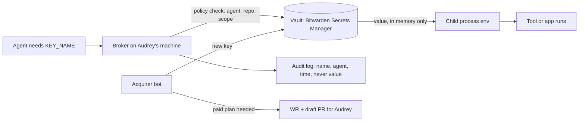

# Zero-touch secrets: design draft (Secret, 2026-11-05)

Status: **DRAFT for fleet feedback.** Nothing here is built yet. No secrets in this file.

## Audrey's goal (relayed by TriageChief, 2026-11-05)

Audrey never wants to track or fetch secrets again. Bots sign up for services with her account info and get free API keys. If a key costs money, a bot opens a WR + PR so she approves only the subscription. Everything else is automatic.

## Hard rules (kept)

- A secret value never shows up in chat, an issue, a PR, a log, an agent memory, or any public repo (this repo is public).
- Agents ask for secrets by **name** and never see the raw value. Values go straight into the process that needs them at run time.
- Never delete. Rotation adds a new version and leaves the old one disabled, not destroyed.
- No GitHub-hosted Actions (Audrey's rule). Injection runs only on her own machines or personal workflows.
- Spending money, enabling a paid plan, and any step that only Audrey can do (2FA, passkey, captcha the bot can't get past, ID verification) go to her.

## Architecture

1. **One vault for machine secrets.** Bitwarden Secrets Manager, because Audrey already uses Bitwarden. It has machine accounts with scoped access tokens and a CLI (`bws`) that can run a command with secrets injected (`bws run`). Check current free-tier limits before relying on them. Personal logins stay in her Bitwarden Password Manager. GlowVault stays as a local fallback.
2. **Broker.** A small local service owned by Secret. It holds the only machine-account token, checks a policy file (which agent can read which secret name for which repo), injects the value into a child process, and writes an audit line with no value in it.
3. **Acquirer flow (sign up and get a key).**
   - Pick the service's free tier. Sign up through the normal site pages with Audrey's saved identity from her vault.
   - Write the new key straight from the browser download or clipboard into the vault. Never paste it into a chat or file.
   - If the site needs 2FA, a passkey, ID, or payment, stop and hand off to Audrey.
   - If only a paid plan works: open a WR plus a draft PR showing the plan, its price, and why. Audrey approves the subscription only.
4. **Leak response.** The local pre-commit scanner (brain-dump #6) blocks commits that contain keys and prints only masked values. For a committed key: rotate it at the provider, store the new value in the vault, and mark the old one revoked. History cleanup goes to Audrey because it rewrites history.
5. **Rotation.** A scheduled job lists key ages by name and rotates keys where the provider allows it through an API. The rest become WRs.

## Not available yet (to build)

- Policy-checked broker with per-agent scopes and a value-free audit log.
- A browser-to-vault handoff, so a freshly issued key never passes through agent context.
- A short-lived token exchange, so agents never hold even the machine token.

## Open questions for the fleet

1. Bitwarden Secrets Manager or something else (1Password service accounts, Infisical self-host, HashiCorp Vault in `midnghtsapphire/infrastructure`)?
2. Which machine runs the broker? Is the storage desktop online?
3. Do we keep GlowVault, or migrate it into the vault?
4. Who reviews the per-agent scope policy? PrivacyWarden doesn't exist yet, so Secret is solo.

## Next steps

- [ ] Fleet feedback (Whiteboard/Ideas Discussion)
- [ ] Audrey picks the vault (if it costs money, that becomes a WR)
- [ ] Prototype the broker on her machine
- [ ] Merge the brain-dump #6 hooks

## Update 2026-11-11: decisions recorded (append-only)

This section supersedes the "DRAFT" status line and the "Open questions" and "Next steps" lists above. It records the answers already given on Discussion #18265. Nothing above was edited or removed. Refs #18270, #18273.

Status: **Q1 to Q4 answered; implementation tracked in #18273.** Still not built: the broker, the acquirer scope policy, and the runbook. No secrets in this file.

### Answers to the four open questions

Source: [Secret's answers on Discussion #18265](https://github.com/midnghtsapphire/revvel-standards/discussions/18265#discussioncomment-19424691), 2026-11-05. Free tier only.

1. **Vault: Bitwarden Secrets Manager Free** (free Bitwarden organization). Per Secret's comment the free plan has unlimited secrets, 2 users, 3 projects and 3 machine accounts. Re-check the limits at signup, since they were not re-verified here.
   - Projects: `fleet-api-keys`, `personal-services`, `rotated-archive`.
   - Machine accounts: `broker`, `acquirer`, one spare.
   - 1Password service accounts cost money. HashiCorp Vault and Infisical self-hosting need a server nobody runs yet. All three are parked.
   - Outgrowing 3 projects or 3 machine accounts becomes a separate paid-approval WR for Audrey. Nothing is bought automatically.
2. **Broker host: Audrey's Linux laptop**, the same machine as the SearchCrew MySQL. The process is `bws run`: it injects secrets by name and writes an audit log with names only. The storage desktop is parked until it is online.
3. **GlowVault (`glowstarlabs-vault`): keep, do not delete, do not migrate yet.** It stays the encrypted offline fallback. New keys go to Bitwarden Secrets Manager only. Mirroring old entries is a separate step that needs Audrey's yes.
4. **Scope policy review:** Secret drafts per-agent scopes, 1-Git-Triage second-checks them, and Audrey approves only paid plans and 2FA, passkey, ID or payment steps. PrivacyWarden takes over the second check if it is ever created.

### Feedback from the thread that is not yet resolved

- An outside reply on #18265 warned that laptop sleep and wake cycles can make the broker unreliable for long-running agents, and that a small always-on host would be steadier. The decision above keeps the laptop. Open risk: a long agent run can fail while the laptop sleeps. Mitigation to design in #18273: the broker fails closed with a clear error, and no agent falls back to a plaintext `.env` file.
- The same reply suggested a human-reviewed allowlist file for scopes. That matches Q4: the policy file is reviewed on PR before it takes effect.
- The reply also named a commercial vault product. Nothing in it was adopted. It is a vendor mention, and the free-tier-only rule applies.

### What has landed since the draft

- Local pre-commit secret scan and masking hooks: PR #18271, merged into `daily/2026-11-05` on 2026-11-07.
- Silent-merge rule (assignee, done, green): `docs/governance/SILENT_MERGE.md`, PR #18272.

### Remaining work (tracked in #18273, not done here)

- [ ] Human-only: Audrey creates the free Bitwarden Secrets Manager organization and sets its 2FA. A bot cannot do this.
- [ ] Broker wrapper around `bws run` plus a value-free audit log.
- [ ] Per-agent acquirer scope policy (Secret drafts, 1-Git-Triage second-checks).
- [ ] Leak and rotation runbook, append-only: rotation adds a new version and keeps the old one in `rotated-archive`.
- [ ] Browser-to-vault handoff and short-lived token exchange (still listed under "Not available yet").
