# Bitchslapper owned execution contract

Contract version: **1.0.0**. Source and governance authority: **revvel-standards**.
Author: Devin, architecture specialist. Date: 2026-11-01.
Request: [parent session](https://app.devin.ai/sessions/a54fa3608b1d4772be10f3683cfbc4bd).
Implementation provenance: [specialist session](https://app.devin.ai/sessions/a611a3acdd5c4a1c9aaabce6375c8a00).

This is an additive, executable shared contract, not another scheduler. It does
not claim a deployed service, production capacity, live local inference, device
access, or passing named BNAT imprint. The four implementation lanes consume it;
the integrator owns cross-lane wiring and the combined draft PR.

## Context and acceptance contract

1. **Context:** `engines/runner-orchestrator/orchestrate.js` already normalizes
   intake, preserves revenue goals, validates state and invokes engines. Its
   default deliver path emits a label consumed by hosted automation; it is not
   an owned durable queue. Its `registry` argument is the extension seam.
   `SYSTEM_STATE.md` describes the standards repository, not a live control DB.
2. **Feature:** specialists can validate a common tenant-scoped job, admission,
   routing, receipt and preservation boundary before integrating implementations.
3. **Dependencies:** existing MySQL-compatible skill-runner stack; Python 3.10+
   for shared types/validation; existing Node/Ajv for JSON schema checks. CUDA
   optional. No paid calls, new secrets, deployment, or device pairing required.
4. **Acceptance:** local Python contract tests; Ajv schema tests; MySQL DDL and
   tenant-FK/constraint tests where an owned disposable MySQL is available;
   focused lint, type and diff checks; preserve root baseline failures in receipts.
   These are not a replacement for integration acceptance in the other lanes.
5. **Scope:** only this directory and `schemas/owned-execution/`. No edits to
   legacy feed, root indexes, registries, governance originals or another repo.
6. **Files:** `interfaces.md`, `safety-and-admission.md`, `traceability.md`,
   provenance receipts; additive migration, Python contract package and tests
   under `schemas/owned-execution/`.
7. **Recovery:** disable the new DB resources with an audited switch; drain or
   revoke existing leases explicitly. Retain all tables and old source. Correct
   schema with a new additive migration, never a destructive down migration.

## Architecture decision: reuse MySQL for control, do not rewrite Octopus

**Define:** the separate `midnghtsapphire/revvel-skill-runner` app uses
`drizzle-orm/mysql-core`, `drizzle-orm/mysql2`, `mysql2`, and `dialect: "mysql"`.
Inspected commit: `4fa601c471116814f2396ff9bcec7d19dc5af54c`. Its actual tables
include `users`, `skills`, `skill_schedules`, `skill_runs` and `error_logs`.
Its `server/llmRouter.ts` still contains a static model catalog; importing that
catalog is not permission to trust old prices or use it as a second active router.
The Next.js app at `products/revvel-skill-runner/` is a different application.

**Assess:** migrating that app wholesale to PostgreSQL is unrequested and risks
breaking users and schedules. Octopus actually uses PostgreSQL and Qdrant; forcing
its native UI/data model onto MySQL would likewise be an unsupported rewrite.
Existing `schemas/credential_modules.sql` is PostgreSQL, so it is not a portable
MySQL bootstrap. Do not run it against MySQL or treat its YAML mirror as live policy.

**Respond:** MySQL **8.0.16+**, InnoDB, strict SQL mode, UTC, is the authoritative
control-plane inventory. New `oe_*` tables coexist with existing tables without
altering them. Both Drizzle and Python DB adapters consume those tables.
MySQL CHECK enforcement must be verified; older MySQL is not an accepted fallback.
Do not claim MariaDB/TiDB parity without running their acceptance suite.
Octopus PostgreSQL stores review-domain data and Qdrant derived embeddings, not
agents, enabled switches, routing, permissions or authoritative job state.

**Evaluate:** contract tests validate boundaries, not a running enterprise SaaS.
The migration is additive and has no tenant/provider/agent seeds. One new agent
is a DB registration, not a new per-agent source file. No production runtime
inventory lives in module globals, JSON/YAML snapshots, pickle, or SQLite.

## One authority and explicit adapters

| Existing source | Additive adapter and ownership | Runtime rule |
| --- | --- | --- |
| Runner orchestrator + engine contract | workers lane supplies engine/runner adapters; control lane persists claims | Reuse intake normalization and goal/state validation in memory; do not call legacy file writer as production persistence |
| `schemas/state.schema.json` | control exports read-only schema-valid historical state | DB transactions are authoritative; JSON is an interchange/export, never polled execution state |
| Drizzle runner `skills`, schedules/runs/users | control maps immutable legacy IDs through `oe_import_links` | Imported skills/schedules/jobs have one `oe_*` identity; legacy scheduler must be fenced for migrated scopes before enablement |
| `skills/REGISTRY.md`, skill sources, hub registry | control imports source ref + commit + hash idempotently | Definitions versioned; enabled, grants, capacity and schedules only DB-driven |
| `.github/labels.yml`, `config/labels-allowlist.yml` | control imports `oe_labels`, projects through outbox | Preserve manual labels; signed API/webhook inputs request transitions, never execute Actions |
| `scripts/local_llm.py`, `scripts/llm-spend-gate.js` | workers adapt local inference with `allow_cloud=False` in LOCAL_ONLY | Existing environment gates can narrow DB authorization, never widen it |
| `products/merge-prosecutor/action/run-prosecutor.mjs` | review lane reuses deterministic prosecution functions | GitHub fetching/issue projection remains optional API adapter; no hosted Action required |
| Octopus native UI/PostgreSQL/Qdrant | review lane maps review/graph artifacts to job/receipt IDs | No duplicate active control registry or scheduler; build source locally, not GHCR |
| `data/subscriptions.yml`, tool/connection inventories | value lane imports dated assertions + upstream/source hash | Old dates/prices remain unverified; no cancellation, paid usage or purchase side effect |
| Desktop/phone | workers own explicit outbound paired connector | This VM is not Audrey's device; no pair means no access |

Import records use unique `(tenant_id, source_system, source_key)` and retain
source commit/hash, imported resource ID and verification time. Reimports of the
same source revision are no-ops; changed assertions create audited revisions.
Do not overwrite operator switches on reimport. Resource capabilities, permissions,
routes, label definitions and schedules are relational rows, not duplicated
hardcoded Python inventories. JSON job payloads/evidence are data, not registries.

## Four lane packages

| Lane | Owned source scope | Installable Python import / boundary |
| --- | --- | --- |
| Control | `engines/owned-control/` | `owned_control`; HTTP/CLI/MCP, auth, DB repositories, admission, jobs/outbox; applies shared DDL via its migration runner |
| Workers | `engines/owned-workers/` | `owned_workers`; worker/provider/connector adapters, leases and sandbox execution; never imports control internals |
| Review | `products/bitchslapper/` | `bitchslapper_review`; native Octopus UI retained, Python review/prosecution/graph/WR/PR adapter |
| Value | `engines/tool-value/` plus assigned docs/Library/skill scopes | `tool_value`; DB import/evaluation/renewal recommendations, no spend/cancellation |
| Shared contract | `schemas/owned-execution/` | `owned_execution_contracts`; stateless types and validation only |

Each lane places its package inside its assigned directory and declares its own
packaging metadata. Do not import `engines.owned-control` or mutate `sys.path` in
production. Local installation: `python3 -m pip install --no-deps
./schemas/owned-execution ./engines/owned-control ./engines/owned-workers` once
those lane packages exist. Shared major version changes require coordinated
adapters; missing/unknown major version is rejected, not guessed.

The shared migration is **the only definition** of these `oe_*` tables. The
control migration runner records its checksum/version in `oe_schema_migrations`;
it must not maintain a divergent copy. Lane-specific migrations may add domain
tables with composite tenant foreign keys and must not redefine shared tables.

## Logical map

```mermaid
flowchart LR
  Owner[Owner / tenant operator] --> Control[owned_control HTTP CLI MCP]
  Gov[revvel governance source at pinned commit] --> Control
  Control --> SQL[(MySQL authoritative oe tables)]
  Old[Existing intake and engine registry] --> Control
  Workers[owned_workers CPU / optional CUDA] --> Control
  Workers --> Local[Enabled healthy LM Studio / Ollama]
  Workers --> Review[bitchslapper_review + native Octopus]
  Review --> PG[(PostgreSQL review data)]
  Review --> Q[(Qdrant derived index)]
  Value[tool_value imports / comparisons] --> Control
  Device[Explicitly paired outbound device] --> Workers
  Control --> Outbox[Durable artifact / label / git API projections]
```

This Markdown-native map intentionally needs no browser, paid rendering service
or network-fetched PlantUML includes. See [interfaces](interfaces.md),
[admission/safety](safety-and-admission.md) and [traceability](traceability.md).
