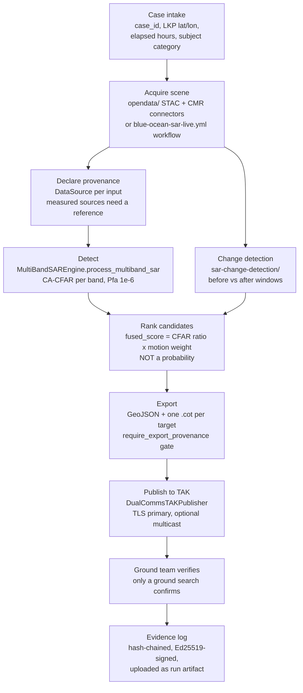
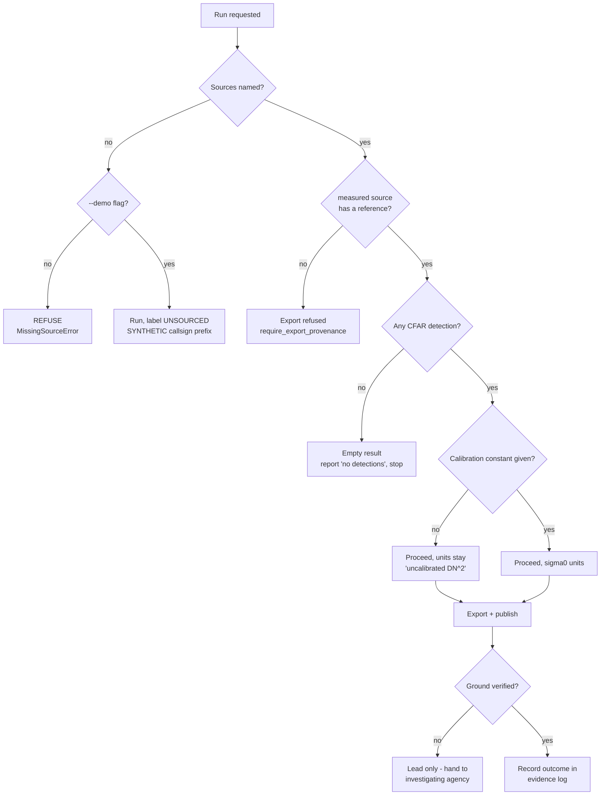
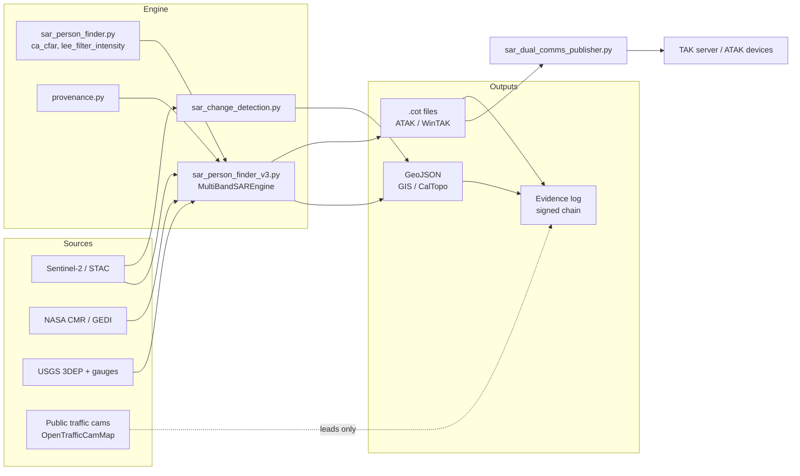
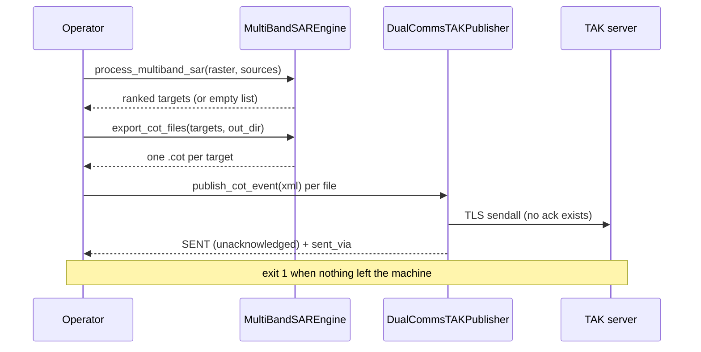

# SAR Investigation Process

A step-by-step process for running a satellite-SAR missing-person investigation
with the tools in this directory. Every output is a **lead for a ground team**,
never a finding: nothing here is validated against field data, and every
location carries `ground_verified: false`.

## Process at a glance

## Steps

1. **Intake.** Record the case ID, last known position (LKP), elapsed hours
   since LKP, and the lost-person category. These drive the motion weight
   (`spread_kmh * elapsed_hours`, placeholder until ISRID/LPB rings land) and
   the live workflow inputs.
2. **Acquire.** Pull imagery and terrain for the case area with the
   `opendata/` connectors (STAC, CMR, USGS 3DEP) or dispatch
   `.github/workflows/blue-ocean-sar-live.yml` with lat/lon/radius and the
   before/after Sentinel-2 windows.
3. **Declare provenance.** Build a `DataSource` list for every input. A
   `measured` or `public_record` source must carry a reference (path, URL or
   scene ID). Without sources the finders raise `MissingSourceError`;
   `--demo` is for demos only and labels output `UNSOURCED`.
4. **Detect.** Run `MultiBandSAREngine.process_multiband_sar`. CA-CFAR runs
   per band on linear intensity; a pixel is a candidate when at least
   `min_detecting_bands` bands detect it. An empty list is a valid answer.
5. **Change detection.** Run `sar-change-detection/` on the before/after
   windows to flag recent ground disturbance near high-ranked candidates.
6. **Export.** `export_geojson` and `export_cot_files` refuse unsourced
   locations (`require_export_provenance`). One `.cot` file per target; UIDs
   are `SAR-<scene sha>-<run id>-R<rank>` so runs never overwrite each other.
7. **Publish.** `DualCommsTAKPublisher.publish_cot_event` over TLS to the TAK
   server. Status is `SENT (unacknowledged)` — bytes left the machine, nothing
   more. Multicast is unencrypted and off by default.
8. **Verify on the ground.** Hand the ranked leads to the field team. A
   detection can be a metal roof, a car or a rock face as easily as a person.
9. **Log evidence.** Every data step lands in the hash-chained evidence log,
   Ed25519-signed when `EVIDENCE_SIGNING_KEY` is set, and uploaded as the run
   artifact.

## Decision tree (gates)

## Data-flow map

## Publish sequence

## Lawful-use gates (summary of README.md)

- Background-check data (census, voter, vital records) falls under FCRA —
  permissible purpose required.
- Cameras: public feeds, your own, or owner/warrant-authorised only (CFAA).
- Output is for the owner's research; hand anything actionable to the
  investigating agency as a lead, never as evidence.
