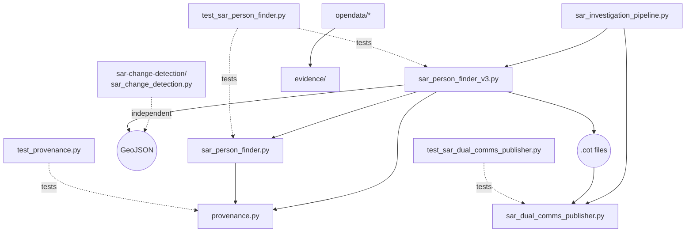
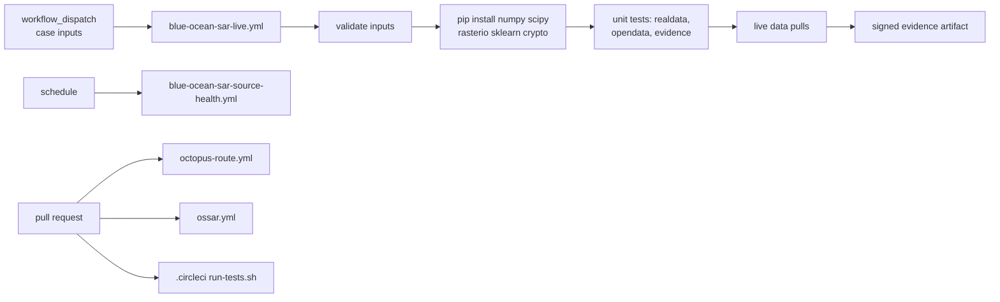

# Repo map — SAR tooling in revvel-standards

Where the SAR work lives and how the pieces depend on each other.

## Directory tree (SAR-relevant)

```text
revvel-standards/
├── .github/workflows/
│   ├── blue-ocean-sar-live.yml          # manual live run: acquire → detect → evidence artifact
│   ├── blue-ocean-sar-source-health.yml # checks the public data sources still answer
│   ├── octopus-route.yml                # PR routing
│   └── ossar.yml                        # static security scan
├── .circleci/scripts/run-tests.sh
├── docs/
│   ├── blue-ocean-sar/
│   │   ├── README.md                    # status of every file + lawful use
│   │   ├── SYSTEM_REVIEW.md             # adversarial review: C1-C5, H1-H6 (fixed)
│   │   ├── INVESTIGATION_PROCESS.md     # the process doc (this change)
│   │   ├── sar_person_finder.py         # ca_cfar, lee_filter_intensity
│   │   ├── sar_person_finder_v3.py      # 6-band engine, GeoJSON + CoT export
│   │   ├── provenance.py                # DataSource, export gates
│   │   ├── sar_dual_comms_publisher.py  # TLS/UDP CoT publisher
│   │   ├── evidence/                    # signed, hash-chained evidence log
│   │   ├── opendata/                    # STAC/CMR/USGS/OSM connectors (Python)
│   │   ├── opendata-rs/                 # Rust twin of opendata
│   │   └── data/                        # sample feeds, dossier, flight plans
│   ├── sar-change-detection/            # before/after disturbance detection
│   ├── case-files/                      # historical case material (as received)
│   └── hfmr/                            # fusion module, own README + tests
└── growlingeyes/tests/                  # sar2optical test
```

## Module dependency graph



## CI / workflow map



## Import rules observed

- `v3` builds on the base finder; both refuse to emit locations without a
  `DataSource` (provenance is the only shared trust layer).
- `opendata/` and `evidence/` are a separate acquisition stack; the finders
  never import them — data crosses as files (rasters, GeoJSON).
- `opendata-rs/` duplicates `opendata/` in Rust and keeps its own evidence
  manifest (known gap M1 in SYSTEM_REVIEW.md).
