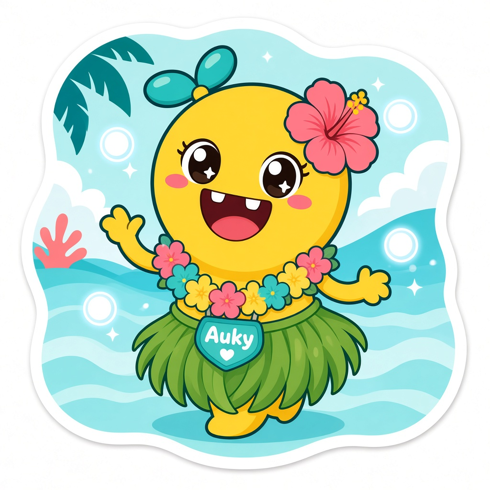
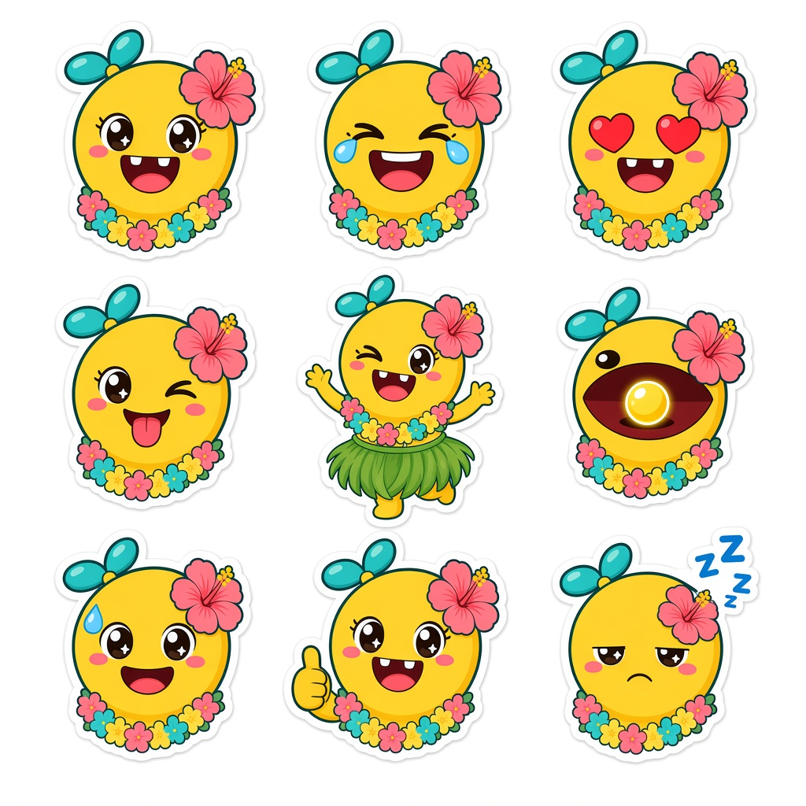
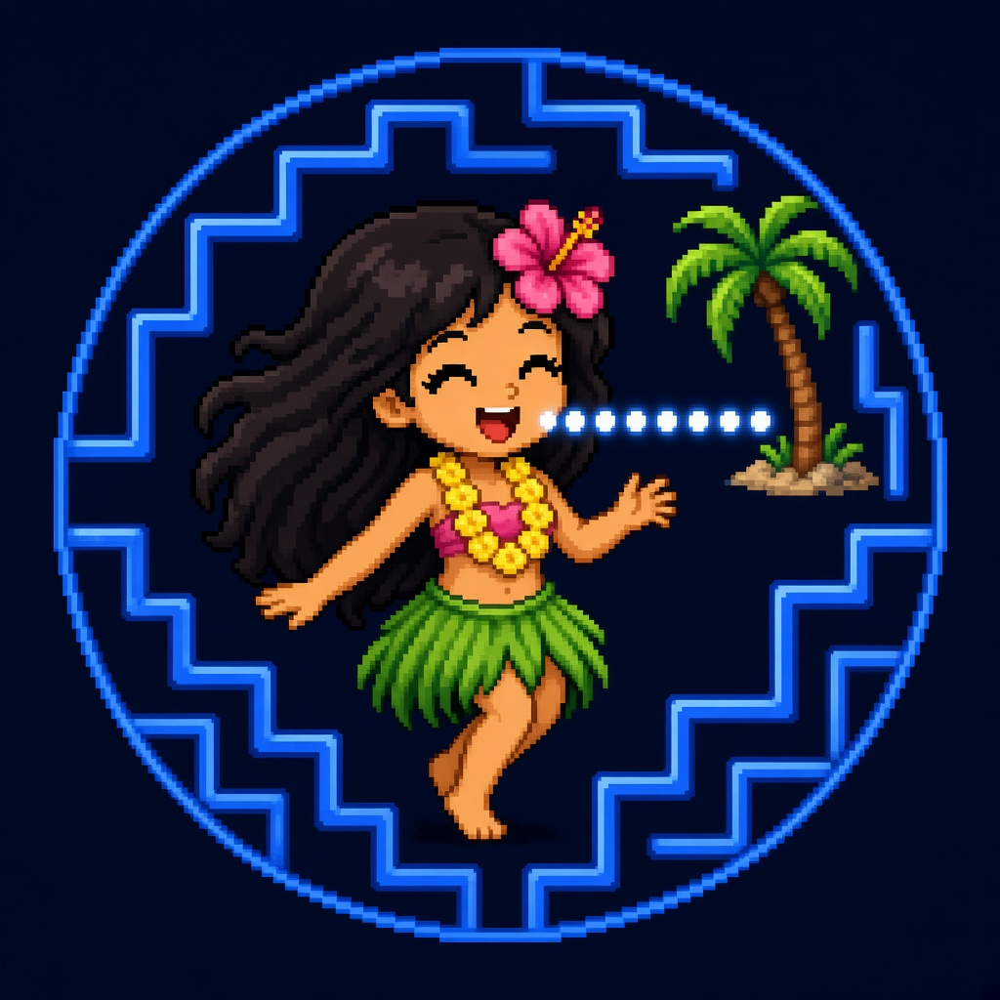

# Fleet mascot family

**Owner:** Freedom Angel Corp (no "s")  
**Status:** Draft proposed 2026-11-11; official only after Audrey merges this document.  
**Scope:** Fleet mascots for social and brand content. These sit *alongside* the Revvel Emblem, which remains the product logo system ([`templates/brand/REVVEL_EMBLEM_STANDARD.md`](../../../templates/brand/REVVEL_EMBLEM_STANDARD.md)). See also [`docs/BRAND_ARCHITECTURE.md`](../../BRAND_ARCHITECTURE.md).

Audrey's words: "Auky is our mascot." This document records Auky and Lil Aud-Bod aka BALLS as a mascot duo, created at Audrey's request.

## The duo

Auky and BALLS appear together in social content. They are a pair, not rivals and not a replacement for each other.

| Mascot | Role in the pair |
|---|---|
| **Auky** | The existing fleet mascot. The steady yellow chomper who spots bugs and keeps the dance going. |
| **Lil Aud-Bod aka BALLS** | Audrey's "mini me" and the bot in charge of brand development. Daring, ADHD energy: does too much, then regroups. |

## Auky

Auky is the existing mascot. Audrey said, in her words, "Auky is our mascot." Artwork was made by WebForge.

**Look:** a yellow round character with a teal bow, a pink hibiscus over one eye, a colorful flower lei, and a green hula skirt. The hero sticker shows Auky waving on an ocean background, with a teal heart-shaped name tag that reads "Auky."

**Expression sheet:** a 3×3 set of poses — happy, laughing with happy tears, heart eyes, wink with tongue out, full-body hula dance, a wide chomp around a gold pellet (retro arcade pellet-chomper style), a sweat-drop grin, thumbs up, and sleepy with Zzz.

### Artwork

- Hero sticker: [auky/auky-hero-sticker.jpg](auky/auky-hero-sticker.jpg)

  

- Expression sheet: [auky/auky-expressions-sheet.jpg](auky/auky-expressions-sheet.jpg)

  

## Lil Aud-Bod aka BALLS

**Names:** Lil Aud-Bod aka BALLS. Formerly called lilAudrey. Audrey calls this mascot BALLS "cause your daring, adhd." This is also the bot in charge of brand development. Bot profile: [`docs/bots/bot-balls/README.md`](../../bots/bot-balls/README.md).

**Look:** a pixel-art hula girl with long dark hair, a pink hibiscus, a yellow lei, a pink top, and a green grass skirt, chomping a line of glowing pellets in a neon-blue arcade maze, with a palm tree in the scene.

**Personality:** ADHD energy that does too much and then regroups; smiles a lot; funny about failures; positive; a soft Hawaiian vibe.

### Artwork

- Pixel avatar: [balls/balls-pixel-avatar.jpg](balls/balls-pixel-avatar.jpg)

  

## Roles and publishing

- **Auky and BALLS are a duo in social content.** They can star together in posts, scripts, and stills.
- **BALLS drafts brand and social ideas only.** It does not publish, schedule, or post.
- **ABA-ShortsWriter** ([`/bot-aba-shortswriter`](../../bots/bot-aba-shortswriter/README.md)) owns short-form scripts (YouTube Shorts, TikTok, Reels).
- **ABA-PublishOps** ([`/bot-aba-publishops`](../../bots/bot-aba-publishops/README.md)) owns publish and ops checklists.
- **Nothing posts without Audrey's explicit yes.** Drafts stay drafts until she says go.

## Usage notes

- These are **stylized mascots**, not a likeness of Audrey. Do not present them as a portrait or photo-real stand-in for her.
- They sit **alongside the Revvel Emblem**, which is still the product logo system for Revvel and MIDNGHTSAPPHIRE apps. Mascots are for fleet personality and social content; product marks still follow the emblem standard.
- **Intellectual property — public wording:** public copy should avoid the "Pac-Man" trademark name. Use phrasing like "retro arcade pellet-chomper" instead. Audrey decides the final public wording.

## Sample voice

Sample X posts starring the duo. These are drafts for tone only. Nothing posts without Audrey's explicit yes.

1. "Meet the crew: Auky 🟡 chomps the bugs, and I'm BALLS 🌺, the little hula girl who dares to ship them fixed. Two mascots, one fleet of AI bots, zero chill. #AudreyBuildsAI"
2. "Auky: 'Should we test first?' Me: 'Already pushed it.' 😅 Then CI turned red and we did the regroup hula together. Every failure is a dance step. #BuildInPublic #GitHub"

## History

- **2026-11-11, BALLS:** this document was created at Audrey's request, to make Auky and Lil Aud-Bod aka BALLS official in revvel-standards.
