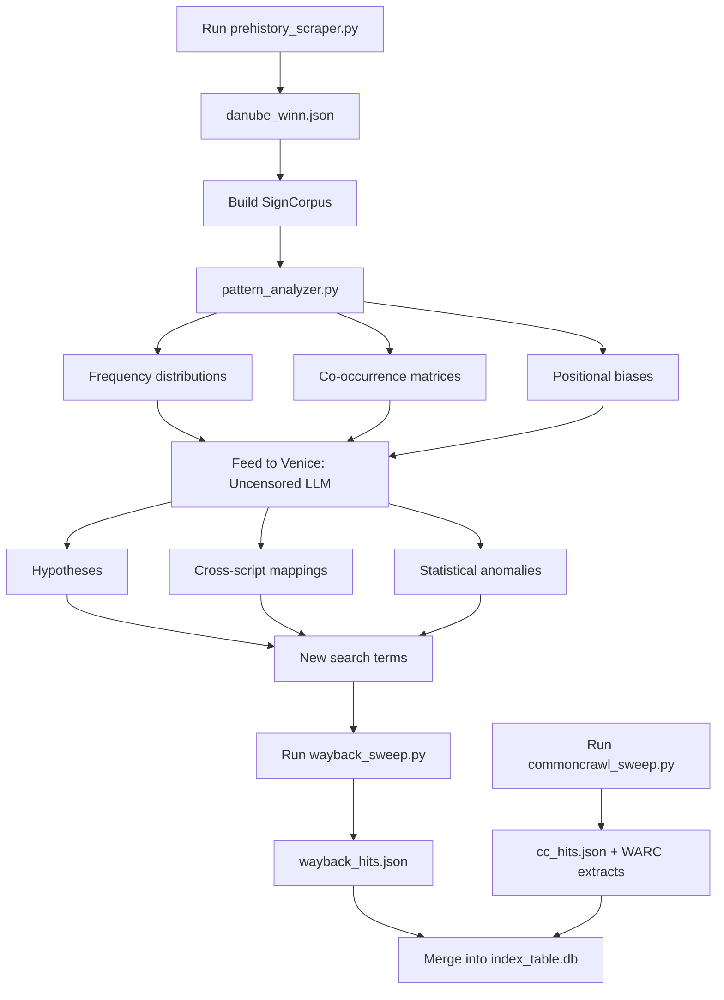

<!--
Status: unverified AI-chat output, collected 2026-11-10. Not run. AI answers are leads, not sources.
-->

# Deep Sweep method pack

Status: unverified AI-chat output, collected 2026-11-10. Not run. AI answers are leads, not sources.

Owner request (2026-11-10, messages t9u and t10u): take the long AI-chat pastes about a "deep sweep and index" method, DatDas, OpenRouter prompts, and related code, and put them in `revvel-standards/docs/deep-sweep/` with subfolders, not on a local drive.

This folder is an archive of those pastes, split out and labeled. Nothing in it has been executed. Do not run the analysis code on Linear A corpus data without a preregistered hypothesis via CorpusBot / Fleet-Orchestrator. Sign runs between dividers are sequences, not words. No API keys are stored here; the only accepted form is the `OPENROUTER_API_KEY` environment variable name.

## Provenance

Audrey pasted outputs attributed to:

| Source in the paste | File |
| --- | --- |
| google/gemma-3-4b, plus a short follow-up in the same stream | [`sources/gemma-3-4b.md`](sources/gemma-3-4b.md) |
| Venice Uncensored | [`sources/venice-uncensored.md`](sources/venice-uncensored.md) |
| DeepSeek V4 Pro 0813 and DeepSeek V4 Pro 0423 | [`sources/deepseek-v4-pro.md`](sources/deepseek-v4-pro.md) |

The Gemma source file is still incomplete as a raw transcript: about 30,883 characters from message t9u were omitted in the first handoff. The bodies of `schema.sql`, `datdas.sql`, and `probe_datdas_domains.py` were later recovered verbatim from Audrey's paste and are now in [`schema/`](schema/) and [`code/ingest/probe_datdas_domains.py`](code/ingest/probe_datdas_domains.py), with unverified/not-run headers. See [`VERIFICATION.md`](VERIFICATION.md).

A dummy OpenRouter key prefix that appeared in a "quick start" line was redacted from the raw sources. Use the environment variable only.

## Layout

```text
docs/deep-sweep/
├── README.md                 # this file
├── VERIFICATION.md           # claims: verified, false, or unverified
├── method/                   # index table, archive layers, daily loop
├── code/
│   ├── ingest/               # wayback_cdx.py, commoncrawl_cdx.py, memento.py, probe_datdas_domains.py
│   ├── analysis/             # ngrams.py (one copy), context_stats.py
│   ├── llm/                  # ask.py
│   ├── src/                  # sweep, scraper, OpenRouter client, analyzer
│   └── requirements.txt
├── schema/                   # index_schema.sql, schema.sql, datdas.sql (t9u bodies recovered)
├── prompts/                  # one file per prompt
└── sources/                  # raw chat transcripts
```

`ngrams.py` appeared several times in the paste; only one copy is kept under `code/analysis/`. `index_table.py` was named in a repo sketch but no source body was in the recovered paste, so it is not invented here. `schema.sql`, `datdas.sql`, and `probe_datdas_domains.py` are the recovered t9u bodies, not invented DDL or scripts.

## Workflow (from the DeepSeek 0423 paste)



This diagram is from the chat. It is not an approved execution plan.

## Quick start (archived; not run)

The paste's setup sketch, with the dummy key line removed:

```bash
# 1. Clone and set up
git init deep-sweep && cd deep-sweep
mkdir -p src data/corpora prompts

# 2. Install dependencies
pip install -r requirements.txt

# 3. Set OPENROUTER_API_KEY in the environment only. Do not write a key into .env
#    in this tree.

# 4. Run the sweeps
python src/prehistory_scraper.py     # Get Danube sign inventory
python src/wayback_sweep.py          # Query Wayback Machine
python src/commoncrawl_sweep.py      # Query Common Crawl

# 5. Analyze patterns
python src/pattern_analyzer.py

# 6. Query the uncensored LLM
python src/openrouter_client.py
```

Do not treat this as a command to run against Linear A corpus data.

## Priority list (from the DeepSeek 0423 paste)

| Priority | Task | Tool |
| --- | --- | --- |
| 1 | Scrape Winn DS inventory from prehistory.it | prehistory_scraper.py |
| 2 | Wayback sweep for all DatDas/Merlini mentions | wayback_sweep.py |
| 3 | Build an index table with everything found | index_table.py + SQLite (no source body recovered) |
| 4 | Feed the Danube sign data to Venice: Uncensored | openrouter_client.py |
| 5 | Cross-reference every Danube sign against Linear A (RILA-S1, GORILA) | pattern_analyzer.py + LLM |
| 6 | Look for the Merlini 2025 paper cross-comparisons | Academia.edu / archive search |
| 7 | Contact Merlini directly for DatDas access | Email |

Priority 7 is already a live owner thread (a licence-style request to Merlini was offered earlier; DatDas Chapter 6 is already held in `tartaria-tablets/sources/`). This list is a lead, not a new work order.

## Related holdings

- DatDas (Merlini): open Chapter 6 copy in `midnghtsapphire/tartaria-tablets` under `sources/`
- GORILA / lineara.xyz papers: `midnghtsapphire/linear-a` (including `src/grammar/lineara.xyz/papers`)
- Packard 1974 PDF: already in the Linear A libraries
- An existing research index: `midnghtsapphire/linear-a` `docs/proposals/deep-index-2026-11-10.csv`

- DatDas folder (2026-11-10): [`docs/datdas/`](../datdas/README.md) — holdings, archive probe, proposed schema, and dated LLM-chat sessions. The databank records are not held. Unverified; not run.
