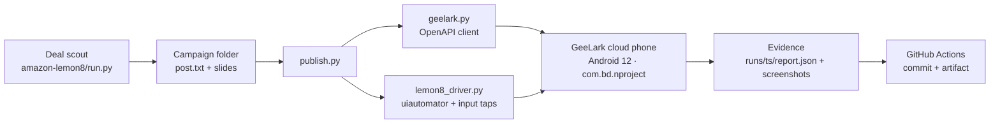
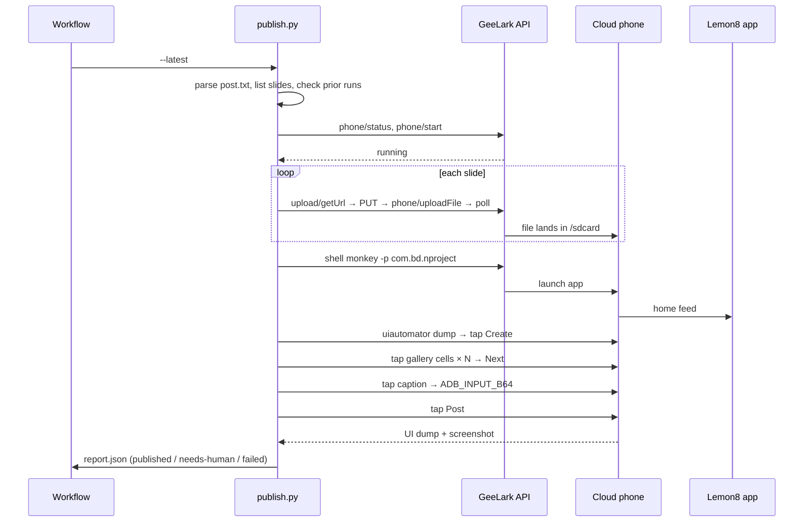

# GeeLark cloud-phone pipeline — architecture

Status: **code complete, awaiting GeeLark credentials and a logged-in phone profile.**
Owner: `automation/lemon8-geelark/`. Runtime: GitHub Actions (`.github/workflows/lemon8-geelark.yml`).

## Why this exists

Lemon8 has no posting API and its website is browse-only (`/creator` and `/upload` return Not
found). The only publishing surface is the Android app. GeeLark provides a persistent virtual
Android device with a stable fingerprint and a web console for the one-time TikTok login; its
OpenAPI exposes shell execution and file upload, which is enough to drive the app end to end.

## Components

| Concern | Implementation |
|---|---|
| Auth | Token (`GEElARK_APP_TOKEN`) or key mode (SHA256 of appId+traceId+ts+nonce+apiKey) |
| Transport | POST JSON to `https://openapi.geelark.com`; retries on 5xx/rate-limit codes |
| Phone lifecycle | `phone/status` → `phone/start` → poll until status 0 |
| Slide transfer | `upload/getUrl` (presigned PUT) → `phone/uploadFile` → poll `uploadFile/result` |
| UI control | `shell/execute` with `uiautomator dump`, `input tap/swipe/text`, `am start` |
| Unicode | ADBKeyboard IME + `ADB_INPUT_B64` broadcast |
| Verification | UI dump markers + GeeLark screenshot API |
| Duplicate guard | `runs/*/report.json` with `status=published` |

## Publish sequence

## Failure model

- `RuntimeError` → exit 2 (`needs-human`): missing element, logged out, app update. The run
  folder keeps `fail-*.xml` and `fail-*.png`; fix `selectors.json` or re-login.
- Other exceptions → exit 1 (`failed`): network/auth/API errors; safe to retry.
- Every report is committed by the workflow, so the history is auditable in `runs/`.

## Selector calibration

`selectors.json` holds candidate labels and ratio fallbacks. The driver prefers the smallest
matching UI node (leaf labels beat full-screen containers) and logs every tap. After an app
update, run `publish.py --calibrate`, compare `calibrate-home.xml`, and update the lists.

## Account and phone hygiene

- One phone per brand account; US proxy/region for a US Lemon8 profile.
- Keep `energySavingMode` off while a publish window is pending (phone auto-shuts down after
  30 min idle otherwise).
- Do not rotate proxies after login; it can trigger a Lemon8 re-verification.
- Max two posts per day; the duplicate guard blocks reposts unless `--force`.

## Activation checklist

- [ ] GeeLark account + cloud phone created (Android 12+, US).
- [ ] Lemon8 (`com.bd.nproject`) installed; TikTok login completed on the phone.
- [ ] ADBKeyboard installed and set as IME.
- [ ] `provision.py --check` passes; `publish.py --calibrate` reviewed.
- [ ] GitHub secrets set: `GEElARK_APP_ID`, `GEElARK_API_KEY` (or `GEElARK_APP_TOKEN`),
      `GEElARK_PHONE_ID`.
- [ ] First live run via `workflow_dispatch` (`dry-run`, then `publish-latest`).
- [ ] Post URL recorded in `docs/posting-status.md`.
